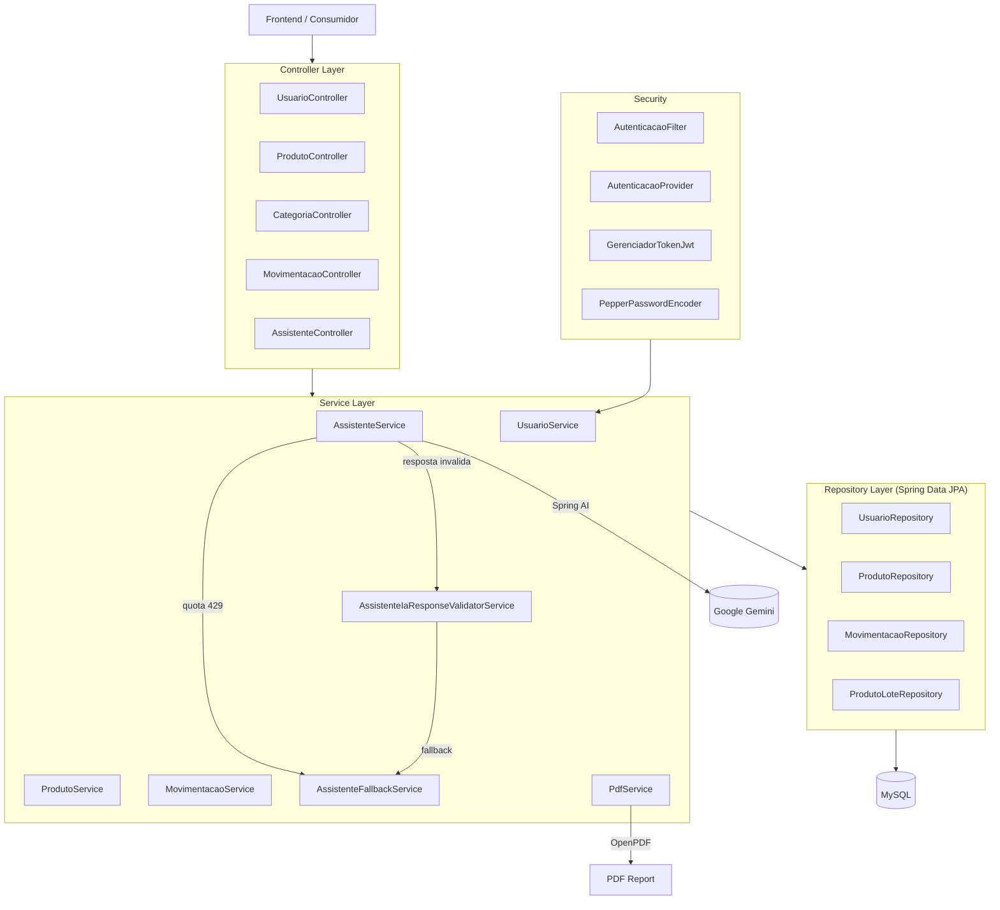

<div align="center">


# Projeto AMAR Backend

**Sistema Inteligente de Gestao de Doacoes para ONGs.**

Gerenciamento de estoque com rotatividade FIFO, relatorios inteligentes via IA e geracao de PDF profissional.


</div>

---

Gerenciamento de estoque completo para uma ONG, com controle de lotes, rotatividade FIFO, autenticacao JWT por cookies, relatorios inteligentes gerados por IA (Google Gemini) e exportacao em PDF com branding profissional. Projetado para voluntarios e administradores, com fallback deterministico quando a IA nao esta disponivel.

## Features

| Feature | Description |
|---|---|
| **Gestao de Estoque** | CRUD de produtos e lotes com categorias fixas, quantidades, validades e datas de entrada |
| **Rotatividade FIFO** | Saidas consomem automaticamente os lotes com menor validade primeiro |
| **Controle de Movimentacoes** | Entrada (doacao recebida), Saida (distribuicao) e Perda (avaria) com registro por lote |
| **Relatorios IA** | Analises inteligentes geradas pelo Google Gemini a partir dos dados reais do banco |
| **Exportacao PDF** | Relatorios formatados com logo da ONG, watermark, cards de prioridade e paginacao |
| **Fallback Inteligente** | Quando a IA falha ou excede quota, um relatorio deterministico e gerado automaticamente |
| **Autenticacao JWT** | Login via HttpOnly cookies com SameSite=Strict, tambem suporta header Bearer |
| **Controle de Acesso** | Roles: ADMINISTRADOR (acesso total) e VOLUNTARIO (acesso limitado) |
| **Soft-Delete** | Usuarios e produtos nunca sao removidos — apenas desativados |
| **Documentacao Swagger** | API documentada com OpenAPI 3, acessivel em `/swagger-ui` |
| **Validacao Multi-Camada** | Respostas da IA sao validadas contra os dados reais antes de serem retornadas |

## Quick Start

### Pre-requisitos

- JDK 21
- MySQL 8+ rodando localmente
- Chave de API do Google Gemini (opcional — funcionalidades de IA desativadas sem ela)

### Configuracao

```bash
cp .env.example .env      # preencha as variaveis de ambiente
```

Os alertas usam um SMTP Gmail configurado separadamente por `ALERT_MAIL_*`. A recuperação de senha continua usando as variáveis originais `MAIL_*`.

### Variaveis de Ambiente

| Variavel | Obrigatoria | Descricao |
|---|---|---|
| `DB_URL` | Sim | URL JDBC do MySQL (ex: `jdbc:mysql://localhost:3306/projeto_amar`) |
| `DB_USER` | Sim | Usuario do MySQL |
| `DB_PASSWORD` | Sim | Senha do MySQL |
| `JWT_SECRET` | Sim | Chave Base64 para assinatura HMAC (>= 32 bytes) |
| `JWT_VALIDITY` | Nao | Validade do token em segundos (padrao: 86400 = 24h) |
| `SECURITY_PEPPER` | Sim | Pepper secreto para hash de senhas |
| `GEMINI_API_KEY` | Nao | Chave de API do Google Gemini |
| `GEMINI_MODEL` | Nao | Modelo de IA (padrao: `gemini-3.6-flash`) |
| `MAIL_FROM` | Sim | Remetente SMTP usado exclusivamente na recuperacao de senha |
| `MAIL_HOST` | Sim | Host SMTP usado exclusivamente na recuperacao de senha |
| `MAIL_PORT` | Nao | Porta SMTP (padrao: `587`) |
| `MAIL_USERNAME` / `MAIL_PASSWORD` | Sim | Credenciais SMTP da recuperacao de senha |
| `ALERT_MAIL_HOST` | Para envio de alertas | Host SMTP de alertas (padrão: `smtp.gmail.com`) |
| `ALERT_MAIL_PORT` | Não | Porta SMTP de alertas (padrão: `587`, com STARTTLS) |
| `ALERT_MAIL_USERNAME` | Para envio de alertas | Conta Gmail usada para enviar os alertas |
| `ALERT_MAIL_PASSWORD` | Para envio de alertas | Senha de app do Gmail; não use a senha normal da conta |
| `ALERT_MAIL_FROM` | Para envio de alertas | Endereço Gmail autenticado, por exemplo `alertas@gmail.com` |
| `ALERTS_EXPIRY_CRON` | Nao | Agendamento do resumo diario de vencimentos (padrao: `0 0 8 * * *`) |
| `ALERTS_TIME_ZONE` | Nao | Fuso do agendamento (padrao: `America/Sao_Paulo`) |

### Executar

```bash
# Windows (PowerShell — carrega .env automaticamente)
.\run.ps1

# Ou via Maven diretamente
.\mvnw.cmd spring-boot:run

# Build e executar JAR
.\mvnw.cmd clean package
java -jar target\projeto-amar-0.0.1-SNAPSHOT.jar
```

### Testes

```bash
.\mvnw.cmd test                              # executar todos os testes (H2 in-memory)
.\mvnw.cmd test -Pcoverage-80                # forcar cobertura minima de 80% nos services
.\mvnw.cmd jacoco:check -Pcoverage-70        # verificar limiar de cobertura
```

## Endpoints

| Metodo | Rota | Autenticacao | Descricao |
|---|---|---|---|
| POST | `/usuarios/cadastrar` | ADMINISTRADOR | Cadastrar usuario |
| POST | `/usuarios/login` | Publico | Login (retorna JWT em cookie) |
| POST | `/usuarios/logout` | Publico | Limpar cookie de autenticacao |
| GET | `/usuarios` | ADMINISTRADOR | Listar usuarios |
| PUT | `/usuarios/{id}` | ADMINISTRADOR | Atualizar usuario |
| DELETE | `/usuarios/{id}` | ADMINISTRADOR | Desativar usuario |
| GET/PUT | `/configuracoes/preferencias-notificacao` | Autenticado | Ler/atualizar preferencias de e-mail do usuario autenticado |
| GET/PUT | `/configuracoes/metricas` | Autenticado | Ler/atualizar limites e periodos globais do sistema |
| POST | `/produtos` | ADMINISTRADOR | Cadastrar produto |
| GET | `/produtos` | Autenticado | Listar produtos |
| PUT | `/produtos/{id}` | ADMINISTRADOR | Atualizar produto |
| DELETE | `/produtos/{id}` | ADMINISTRADOR | Desativar produto |
| GET | `/dashboard/estoque-atual-por-produto` | Autenticado | Listar produtos ativos, categorias e quantidades atuais em estoque |
| GET | `/dashboard/kpi-vencimento-7-dias` | Autenticado | Somar unidades de produtos ativos que vencem de hoje ate hoje + 7 dias (inclusive) |
| GET | `/dashboard/kpi-estoque-baixo?limite=10` | Autenticado | Somar unidades de produtos ativos cujo estoque total e menor que o limite positivo obrigatorio |
| GET | `/dashboard/kpi-doacoes-semana` | Autenticado | Contar registros de entrada de segunda-feira ate hoje (inclusive), pela data da movimentacao |
| GET | `/dashboard/kpi-sem-movimentacao-60-dias` | Autenticado | Somar estoque de produtos ativos sem movimentacao de hoje - 59 dias ate hoje, incluindo produtos nunca movimentados |
| GET | `/dashboard/modal-kpi-risco-vencimento` | Autenticado | Listar lotes ativos em estoque dentro do periodo de risco configurado |
| GET | `/categoria` | Autenticado | Listar valores fixos para o select de categorias |
| POST | `/movimentacao/entrada` | Autenticado | Registrar entrada de estoque |
| PUT | `/movimentacao/entrada/{id}` | Autenticado | Atualizar entrada |
| DELETE | `/movimentacao/entrada/{id}` | Autenticado | Remover entrada |
| GET | `/movimentacao/entrada/historico` | Autenticado | Historico paginado de entradas |
| POST | `/movimentacao/saida` | Autenticado | Registrar saida (FIFO) |
| PUT | `/movimentacao/saida/{id}` | Autenticado | Atualizar saida |
| DELETE | `/movimentacao/saida/{id}` | Autenticado | Remover saida |
| GET | `/movimentacao/saida/historico` | Autenticado | Historico paginado de saidas |
| POST | `/movimentacao/perda` | Autenticado | Registrar perda |
| PUT | `/movimentacao/perda/{id}` | Autenticado | Atualizar perda |
| POST | `/assistente/relatorio/entradas` | Publico | Relatorio IA: historico de entradas |
| POST | `/assistente/relatorio/saidas` | Publico | Relatorio IA: historico de saidas |
| POST | `/assistente/relatorio/desempenho-geral` | Publico | Relatorio IA: desempenho geral |
| POST | `/assistente/relatorio/produtos-cadastrados` | Publico | Relatorio IA: produtos cadastrados |
| POST | `/assistente/relatorio/*/pdf` | Publico | Versao PDF de qualquer relatorio |

## Architecture



### Camadas

| Camada | Responsabilidade |
|---|---|
| **Controller** | Endpoints REST, validacao de entrada, mapeamento HTTP |
| **Service** | Logica de negocio, orquestracao, regras de estoque |
| **Repository** | Consultas JPA, queries customizadas, agregacoes |
| **Config** | Seguranca JWT, CORS, inicializacao do admin padrao |
| **Mapper** | Conversao Entity <-> DTO |
| **Exception** | Excecoes de dominio organizadas por entidade |

### Comportamento do Cache IA

Quando a IA responde corretamente, a resposta e validada multi-camada antes de ser retornada. Quando a IA falha:

| Falha | Comportamento |
|---|---|
| Quota excedida (HTTP 429) | Fallback deterministico com aviso de indisponibilidade |
| Resposta nao aderente | Fallback gera relatorio estruturado a partir dos dados brutos |
| Resposta validada | PDF exibe banner laranja indicando modo fallback |

## Tech Stack

| Componente | Tecnologia |
|---|---|
| Linguagem | Java 21 |
| Framework | Spring Boot 4.0.5 |
| Build | Maven (wrapper) |
| ORM | Spring Data JPA + Hibernate |
| Banco de Dados | MySQL 8 (producao) / H2 (testes) |
| Seguranca | Spring Security + JWT (jjwt 0.12.5) |
| Senhas | Argon2 + HMAC-SHA256 pepper |
| IA | Spring AI 2.0 + Google Gemini (`gemini-3.6-flash`) |
| PDF | OpenPDF (LibrePDF) 1.3.39 |
| Documentacao | SpringDoc OpenAPI 2.5.0 |
| Testes | JUnit 5 + Mockito |
| Cobertura | JaCoCo 0.8.12 |

## Project Structure

```
projeto-ong-amar-backend/
├── src/main/java/school/sptech/projeto_amar/
│   ├── ProjetoAmarApplication.java
│   ├── config/
│   │   ├── SecurityConfiguracao.java         # Spring Security + CORS + endpoints
│   │   ├── AutenticacaoFilter.java           # JWT filter (cookie + header)
│   │   ├── AutenticacaoProvider.java         # Custom authentication provider
│   │   ├── GerenciadorTokenJwt.java          # JWT generation/validation
│   │   ├── PepperPasswordEncoder.java        # Argon2 + HMAC-SHA256 pepper
│   │   └── AdminInitializer.java             # Seeds default admin on first run
│   ├── domain/
│   │   ├── Usuario.java                      # User entity
│   │   ├── Produto.java                      # Product entity
│   │   ├── enums/Categoria.java              # Fixed category enum
│   │   ├── ProdutoLote.java                  # Batch tracking (qty, expiry)
│   │   ├── Movimentacao.java                 # Stock movement
│   │   ├── MovimentacaoEstoque.java          # Movement-to-batch join
│   │   └── enums/                            # TipoUsuario, TipoMovimentacao
│   ├── repository/                           # Spring Data JPA interfaces
│   ├── service/
│   │   ├── MovimentacaoService.java          # FIFO stock logic
│   │   ├── AssistenteService.java            # AI report generation
│   │   ├── AssistenteFallbackService.java    # Deterministic fallback
│   │   ├── AssistenteIaResponseValidatorService.java  # AI validation
│   │   └── PdfService.java                   # PDF generation
│   ├── controller/                           # REST endpoints
│   ├── dto/                                  # Request/Response records
│   ├── mapper/                               # Entity <-> DTO mapping
│   ├── exception/                            # Domain exceptions by entity
│   └── event/
│       └── PdfRelatorioPageEvent.java        # PDF header/watermark/footer
├── src/main/resources/
│   ├── application.properties                # Config (env var placeholders)
│   ├── schema.sql                            # MySQL DDL
│   └── static/logo-amar.png                  # NGO logo for PDFs
├── src/test/                                 # JUnit 5 + Mockito tests (H2)
├── .env.example                              # Environment template
├── run.ps1                                   # PowerShell launcher
└── pom.xml                                   # Maven config
```

### Schema do Banco

```
              produto ──< produto_lote
                              │
usuario ──< movimentacao ──< movimentacao_estoque >──┘
```

O fluxo de categorias nao depende mais de uma tabela `categoria`. O campo
`produto.categoria` armazena os valores fixos `ALIMENTOS` e `PRODUTOS DE HIGIENE`.

### Categorias no frontend

O select deve enviar o valor da categoria diretamente no cadastro ou atualizacao
de produtos, substituindo o antigo campo `fkCategoria`:

```json
{"nome":"Arroz","unidadeMedida":"kg","categoria":"ALIMENTOS"}
```

Para produtos de higiene, use `"categoria":"PRODUTOS DE HIGIENE"` (com espacos).
`GET /categoria` retorna `["ALIMENTOS","PRODUTOS DE HIGIENE"]`, caso o frontend
queira carregar as opcoes pela API. Nao existem mais endpoints de cadastro,
edicao ou exclusao de categorias.

Requests e responses de produtos usam a categoria como string, nao como objeto
com ID. O filtro `GET /produtos?categoria=ALIMENTOS` usa os mesmos valores.
Valores desconhecidos sao rejeitados; categoria e unidade de medida podem ser
`null`, conforme o schema. Nome e unidade de medida possuem limite de 45 caracteres.
`dataCadastro` foi removido do fluxo de produtos porque a coluna nao existe mais.
Dashboard e relatorios mantem os nomes de exibicao das categorias.

Preferencias, configuracoes e autenticacao nao foram alteradas nesta adaptacao.
`schema.sql` nao migra bancos existentes: antes de usar um banco antigo, converta
as categorias para o ENUM e remova a antiga constraint/coluna `fk_categoria`
e a coluna `data_cadastro`, preservando os dados necessarios em backup.

## API Documentation

A documentacao interativa da API esta disponivel via Swagger UI:

```
http://localhost:8080/swagger-ui
http://localhost:8080/v3/api-docs
```

### Notificacoes por e-mail

As preferencias de notificacao sao individuais por usuario e ficam no backend. O SMTP separado de alertas envia avisos de estoque baixo, risco de vencimento e novas movimentacoes `ENTRADA`/`SAIDA`; `PERDA` reavalia o estoque baixo, mas nao e tratada como uma nova saida. Os alertas sao enfileirados depois do commit e processados em segundo plano, sem segurar a resposta HTTP da movimentacao. O alerta de estoque baixo e enviado na transicao para abaixo do limite configurado. O resumo de risco de vencimento e verificado diariamente no horario definido por `ALERTS_EXPIRY_CRON`.

Configure uma senha de app do Gmail nas variaveis `ALERT_MAIL_*`. A recuperacao de senha continua usando a configuracao SMTP `MAIL_*`, sem alteracoes.

Para o passo a passo de configuração e uso, consulte [`docs/README_NOTIFICACOES_GMAIL.md`](docs/README_NOTIFICACOES_GMAIL.md).

## License

MIT
