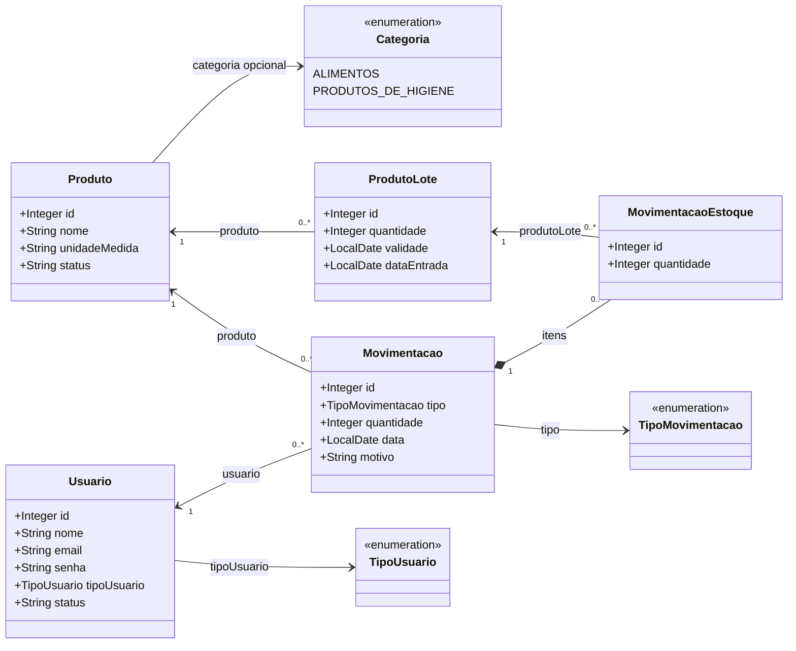
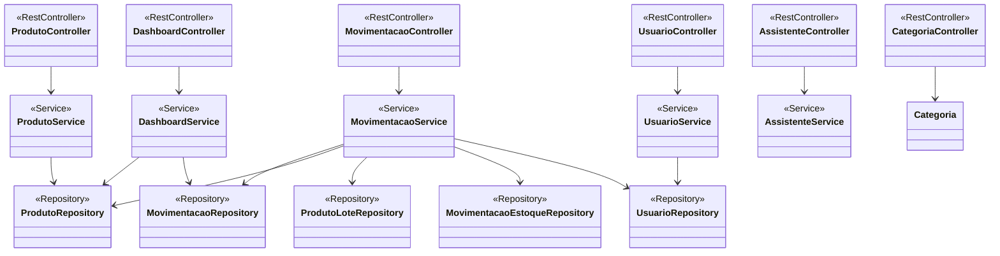

# Diagrama de Classes

## Modelo de dominio

## Camadas da aplicacao

As classes de DTO, mappers, configuracao e excecoes foram omitidas para manter o foco no modelo persistido e no fluxo principal da aplicacao.